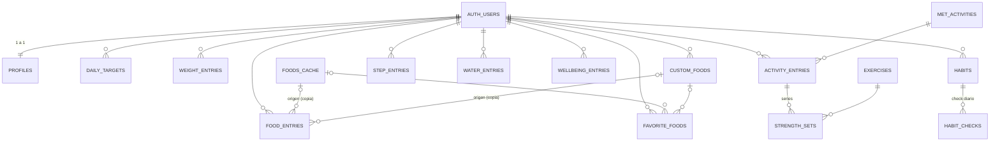

# Modelo de datos

El SQL está en [`supabase/migrations/`](../supabase/migrations) y se aplica en este orden:

| Archivo | Contenido |
| --- | --- |
| `20261124150000_esquema_inicial.sql` | Tipos, tablas, índices, triggers y la función de rate limiting |
| `20261124150100_rls_y_permisos.sql` | GRANT/REVOKE y todas las políticas RLS |
| `20261124150200_datos_de_referencia.sql` | Tabla MET (35 actividades) y ejercicios de gimnasio (31) |

Los tests (`supabase/tests/`) se corren con `scripts/test-db.sh` y en el CI de GitHub.

## Diagrama

## Tablas

**De usuario** (RLS: cada uno ve y modifica solo lo suyo)

| Tabla | Una fila es… | Clave única |
| --- | --- | --- |
| `profiles` | El perfil (sexo, nacimiento, altura, actividad, zona horaria, objetivo, ritmo) | `id` = usuario |
| `daily_targets` | La meta calculada de un día (kcal, proteína, agua) | usuario + fecha |
| `weight_entries` | El peso de un día | usuario + fecha |
| `food_entries` | Un alimento registrado en una comida, con copia de sus nutrientes | — |
| `custom_foods` | Un alimento cargado a mano | — |
| `favorite_foods` | Un favorito (del caché o personalizado) | usuario + alimento |
| `activity_entries` | Una sesión de actividad, con MET y kcal calculadas | — |
| `strength_sets` | Una serie de un ejercicio dentro de una sesión | — |
| `step_entries` | Los pasos de un día | usuario + fecha |
| `water_entries` | Un toque de "+250 ml" | — |
| `wellbeing_entries` | Sueño y ánimo de un día | usuario + fecha |
| `habits` | Un hábito creado por el usuario | — |
| `habit_checks` | Un hábito cumplido un día | hábito + fecha |

**De referencia** (solo lectura para usuarios con sesión): `met_activities`, `exercises`, `foods_cache`.

**Internas** (sin acceso por API): `food_search_cache`, `rate_limits`.

## Decisiones

- **El peso actual no está en el perfil.** Es el último registro de `weight_entries`. Guardarlo en los dos lados permitiría que se desincronicen.
- **"Recientes" no es una tabla.** Sale de las últimas `food_entries` (índice `user_id, created_at desc`).
- **Copia de nutrientes.** `food_entries` guarda los valores por 100 g/ml al momento de registrar, y los totales (`kcal`, `protein_g`, etc.) son **columnas generadas**: siempre coinciden con cantidad × valores, y nadie puede guardar totales falsos.
- **`daily_targets` guarda la meta de cada día.** Si cambiás tu nivel de actividad hoy, la meta de la semana pasada no cambia. También es donde la Fase 2 va a escribir la meta recalibrada (`source = 'adaptive'`).
- **Doble conteo de pasos.** `activity_entries.steps_included` guarda los pasos que una caminata o carrera ya cuenta como ejercicio; el cálculo de los pasos del día los descuenta.
- **Calorías de ejercicio netas.** `activity_entries.kcal` se calcula con (MET − 1), es decir, solo lo que se suma por encima del basal.
- **Hábitos archivados, no borrados.** Así las rachas y el historial no se pierden.
- **Agua en filas sueltas.** Cada toque es una fila; "deshacer" borra la última.

## Fase 2: cómo se suma sin romper nada

| Funcionalidad | Cambio previsto |
| --- | --- |
| Ajuste automático del gasto | Un servicio que compara kcal registradas vs. tendencia de peso y escribe `daily_targets` con `source = 'adaptive'`. Sin cambios de esquema |
| Foto de comida con IA | Un nuevo `FoodProvider`; las entradas se guardan igual que hoy |
| Recetas | Tablas `recipes` y `recipe_ingredients` (mismo patrón de RLS); `food_source` suma `'recipe'` |
| Medidas, % de grasa y fotos | Tabla `body_measurements` + bucket privado de Supabase Storage con política por carpeta `{user_id}/…` |
| Rutinas y récords | Tablas `routines` y `routine_exercises`; los récords salen de `strength_sets` |
| Energía, hambre, alcohol | Columnas nuevas opcionales en `wellbeing_entries` |
| Ciclo menstrual (opcional) | Tabla aparte con consentimiento explícito, por ser un dato aún más sensible |
| Apple Health / Health Connect | Columna `origin` en las tablas de registros para distinguir carga manual de importada |
| Recordatorios | Tabla `notification_preferences` + suscripciones Web Push |
